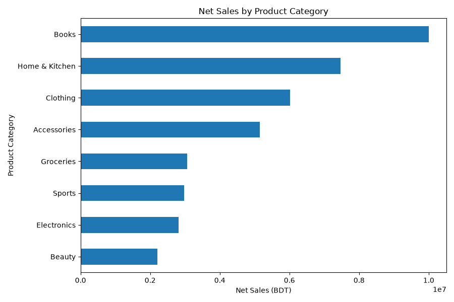
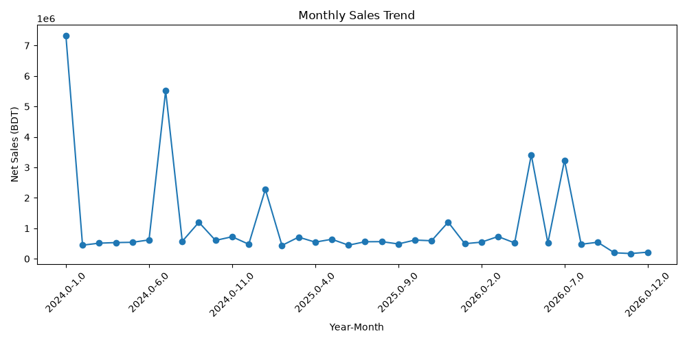
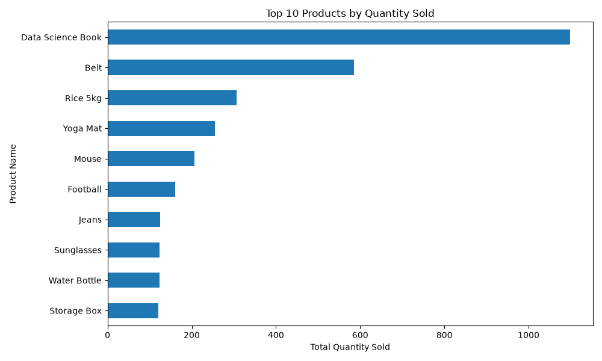
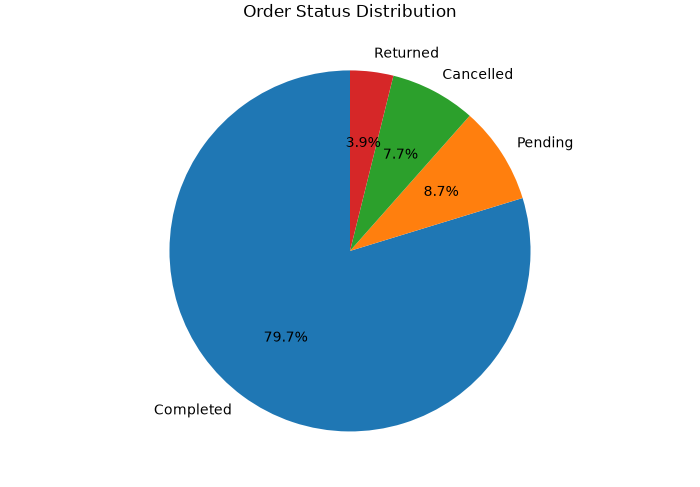

# E-commerce Sales Analysis with Pandas

A beginner-friendly data analytics project where I take a **messy e-commerce orders dataset**, clean it step by step with **Python (Pandas)**, and turn it into clear business insights and charts.

> **Goal:** practice the full analytics workflow: load → inspect → clean → engineer features → analyze → visualize → explain.

---

## Dataset

| Item | Detail |
|---|---|
| Source | Synthetic practice dataset (intentionally messy) |
| File | `messy_ecommerce_orders_1500.csv` |
| Size | 1,518 rows × 15 columns (1,500 after removing duplicates) |
| Period | Jan 2024 – Sep 2026 |
| Currency | BDT (Bangladeshi Taka) |

**Columns:** Order_ID, Order_Date, Customer_Name, Age, City, Product_Category, Product_Name, Quantity, Unit_Price_BDT, Discount_Percent, Payment_Method, Order_Status, Sales_Channel, Customer_Rating, Delivery_Days

---

## Tools Used

- Python
- Pandas
- Matplotlib

---

## Data Quality Problems Found & How I Fixed Them

| Problem | Count | Fix |
|---|---|---|
| Duplicate rows | 18 | Removed with `drop_duplicates()` |
| Missing values (name, age, city, category, quantity, price, discount, payment, rating, delivery) | 10 columns affected | Median for Age / Rating / Delivery_Days, `0` for Discount, `"Unknown"` for text columns. Quantity and Price were **not** guessed |
| Inconsistent text (`" dhaka "`, `"ELECTRONIC"`, `"cloth"`) | several columns | `strip()` + `title()` + replace map |
| Mixed date formats (`2025-01-11`, `2025/09/29`, `27/10/2025`, `Apr 04, 2025`, `not available`) | 5 unparseable | Parsed one format at a time, bad values become `NaT` |
| Impossible values (Age 999, Quantity -2, Price 1,000,000, Rating 100, Discount 999%, Delivery 365 days) | 46 values | Treated as invalid → set to missing, then handled like other missing values |

---

## Project Workflow

1. **Load** the CSV
2. **Data quality check:** missing values, duplicates, data types, unique values
3. **Cleaning:** duplicates, text standardization, dates, invalid values, missing values
4. **Feature engineering:** `Gross_Sales_BDT`, `Discount_Amount_BDT`, `Net_Sales_BDT`, `Year`, `Month`
5. **Analysis:** sales by category, city, product, month, order status and payment method
6. **Visualization:** 4 charts saved in `Picture/`
7. **Business insights**

---

## Key Findings

> Sales figures use 1,415 of 1,500 orders. The other 85 have a missing or invalid Quantity or Price, so I did not guess their value.

- **Total Net Sales:** ৳19.78 million (about ৳15.73 million from *Completed* orders only)
- **Average order value:** ৳13,979
- **Best-selling category:** Clothing (৳2.85M), followed closely by Books (৳2.72M) and Home & Kitchen (৳2.66M)
- **Lowest category:** Electronics (৳2.20M). Categories are fairly balanced, with no single dominant one
- **Top cities by Net Sales:** Gazipur, Sylhet, Khulna, Cumilla, Chattogram
- **Most sold products (units):** Storage Box (120), Jeans (117), Water Bottle (117)
- **Order status:** 79.7% Completed, 8.7% Pending, 7.7% Cancelled, 3.9% Returned. About 1 in 9 orders is lost to cancellation or return
- **Payment:** Card is the most used method, but all five methods are close
- **Monthly trend:** Sales stay in the ৳0.4M – ৳0.7M range most months, with a peak in **March 2026 (৳0.89M)**

---

## Charts

### Net Sales by Product Category


### Monthly Sales Trend


### Top 10 Products by Quantity Sold


### Order Status Distribution


---

## What I Learned

- Real data is messy. **Cleaning took more effort than the analysis itself.**
- `dayfirst=True` can silently flip day and month in ISO dates (`2024-12-10` becomes `2024-10-12`) and this quietly corrupts any monthly analysis. The safe way is to parse each date format explicitly.
- A few impossible values (like Quantity = 999 or Price = 1,000,000) were enough to **double the total sales and change the best category.** Checking for invalid values is not optional, and you must also *fix* them, not just print them.
- Missing numbers should be handled carefully. Guessing money values can hide the truth.

---

## How to Run

```bash
# 1. Clone the repository
git clone https://github.com/<mdgolamrabbi22>/ecommerce-sales-analysis-pandas.git
cd ecommerce-sales-analysis-pandas

# 2. Install dependencies
pip install -r requirements.txt

# 3. Run the analysis
python main.py
```

This prints the cleaning summary and business insights, saves the charts in `Picture/`, and writes `cleaned_ecommerce_orders.csv`.

---

## Project Structure

```
ecommerce-sales-analysis-pandas/
├── main.py                           # full cleaning + analysis + charts
├── messy_ecommerce_orders_1500.csv   # raw data
├── cleaned_ecommerce_orders.csv      # cleaned data
├── Picture/                          # saved charts
├── requirements.txt
├── .gitignore
└── README.md
```

---

## Next Steps

- Build an interactive dashboard in Power BI or Tableau
- Add customer segmentation (age group, city)
- Write the same analysis in SQL
- Compare revenue lost to cancelled and returned orders

---

## Author

**<Md Golam Rabbi>**
[LinkedIn](https://www.linkedin.com/in/md-golam-rabbi-11a920330/) · [GitHub](https://github.com/mdgolamrabbi22)
