# E-Commerce Orders: Data Cleaning & Visualization

A data analysis project on a messy e-commerce orders dataset from Bangladesh. The raw data is cleaned step by step in a Jupyter notebook, and the cleaned data is then explored with charts to understand customers, sales, payments and deliveries.

## Project Structure

```
E-Commerce Data/
├── messy_ecommerce_orders.csv   # Raw, messy dataset (input)
├── Data_Cleaning.ipynb          # Cleaning notebook (raw -> clean)
├── Clean_data.csv               # Cleaned dataset (output)
├── Data_Visualize.ipynb         # EDA & visualization notebook
└── Graph/                       # Exported charts (Graph1.png, graph2.png ... graph12.png)
```

## Dataset

| | Raw (`messy_ecommerce_orders.csv`) | Clean (`Clean_data.csv`) |
|---|---|---|
| Rows | 1,055 | 954 |
| Columns | 17 | 17 |
| Order period | | 2024-01-02 to 2025-08-22 |

### Columns (clean data)

| Column | Description |
|---|---|
| `Order_Id` | Unique order ID (e.g. `ORD10665`) |
| `Customer_Id` | Customer ID (e.g. `C278`); some are missing |
| `Customer_Name` | Customer name |
| `Age` | Customer age |
| `Gender` | Male / Female / Unknown |
| `City` | Dhaka, Chattogram, Khulna, Sylhet, Rajshahi, Barishal, Unknown_City |
| `Category` | Beauty, Sports, Electronics, Clothing, Books, Home & Kitchen, Missing |
| `Unit_Price` | Price per unit |
| `Qty` | Quantity ordered |
| `Discount_Pct` | Discount percentage (0, 5, 10, 15, 20, 25) |
| `Payment_Method` | Bkash, Nagad, Debit Card, Credit Card, Cash On Delivery, Missing |
| `Order_Date` | Order date (`YYYY-MM-DD`) |
| `Ship_Date` | Shipping date (`YYYY-MM-DD`) |
| `Delivery_Status` | Delivered, Returned, Cancelled, In Transit |
| `Customer_Rating` | Rating from 1 to 5 (missing if not given) |
| `Is_Member` | Yes / No |
| `Total_Amount` | Final order amount after discount |

## 1. Data Cleaning (`Data_Cleaning.ipynb`)

The raw file had inconsistent formatting, typos, placeholder values and mixed data types. Main steps:

- **Column names**: stripped, title-cased and spaces replaced with underscores (`customer name` -> `Customer_Name`).
- **Age**: converted to numeric (text like `thirty` became NaN), outliers removed using a Z-score (|z| > 3), and missing values filled with the mean.
- **Gender**: standardized (`M`/`F`/`MALE` -> `Male`/`Female`); `?`, `-`, `Missing` -> `Unknown`.
- **City**: fixed spelling variants (`Chittagong`/`Ctg` -> `Chattogram`, `Sylet` -> `Sylhet`, `Dahka` -> `Dhaka`, `Rajshai` -> `Rajshahi`, `Barisal` -> `Barishal`); unknown values -> `Unknown_City`.
- **Category & Payment Method**: trimmed, title-cased, merged variants (`COD` -> `Cash On Delivery`); missing values labeled `Missing`.
- **Dates**: parsed 5 different formats (`dd/mm/yyyy`, `mm-dd-yyyy`, `yyyy-mm-dd`, `15 Jan 2025`, `January 18, 2025`) into one standard format.
- **Customer Rating**: kept only whole numbers between 1 and 5; everything else -> NaN.
- **Duplicates**: removed by `Order_Id`.
- **Missing numeric values**: rows without `Unit_Price` or `Total_Amount` were dropped; invalid `Unit_Price`, `Qty` and `Discount_Pct` were set to NaN and then **recovered by back-calculating from `Total_Amount`**:
  `Total = Unit_Price x Qty x (1 - Discount / 100)`
- Final result saved as `Clean_data.csv`.

## 2. Data Visualization (`Data_Visualize.ipynb`)

The cleaned data is explored with Seaborn / Matplotlib charts, including:

- Customer rating by city
- Category distribution by city
- Total sales quantity by category
- Total sales quantity by delivery status
- Delivery status by city
- Membership (member / non-member) by city
- Category-wise order amount
- Gender-wise category preference
- City-wise and gender-wise payment methods
- City-wise customer distribution
- Quantity sold by discount group (0-5%, 6-10%, 11-20%, 21-30%, 30%+)
- Customer rating by category

All exported charts are in the [`Graph/`](Graph) folder.

## Graph Gallery

| | | |
|---|---|---|
| 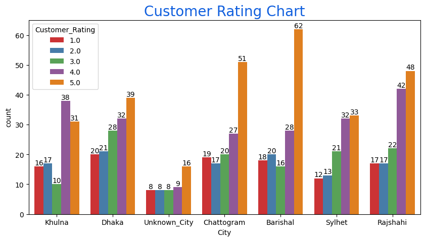 | 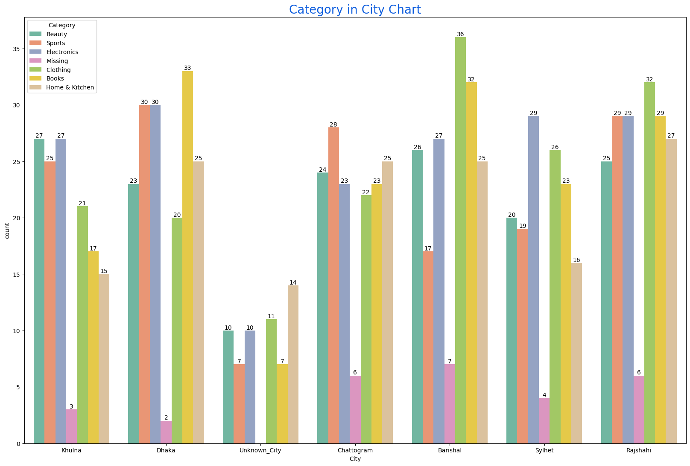 | 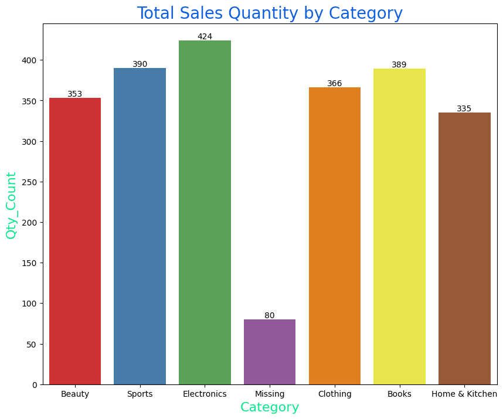 |
| 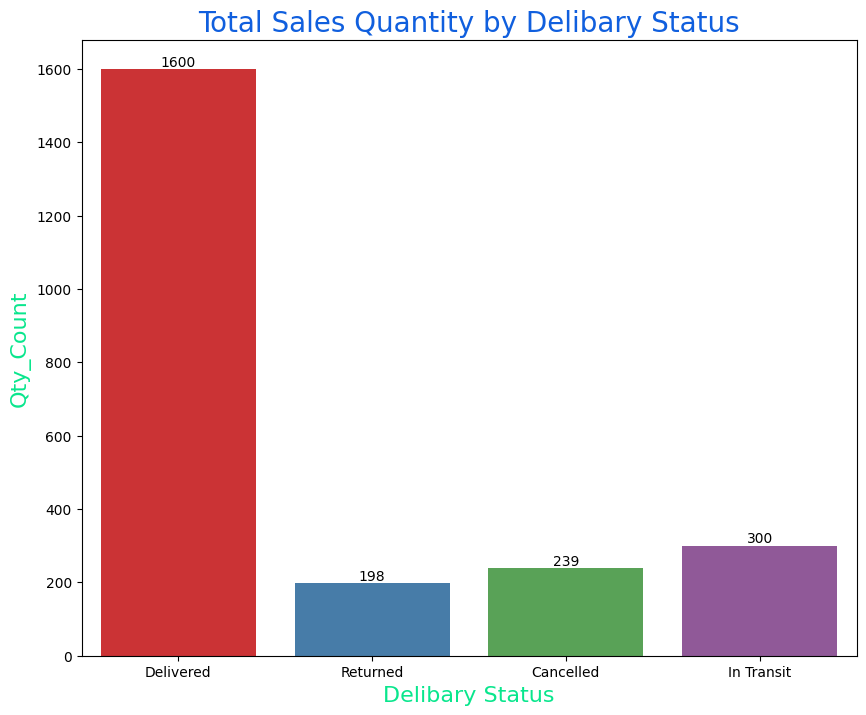 | 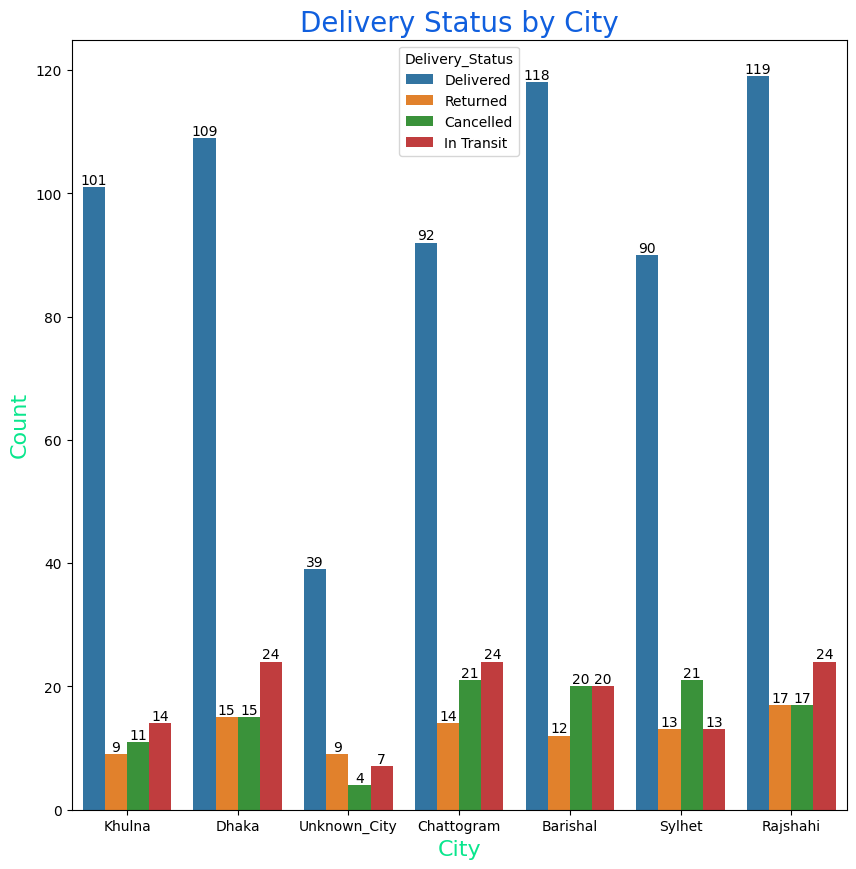 | 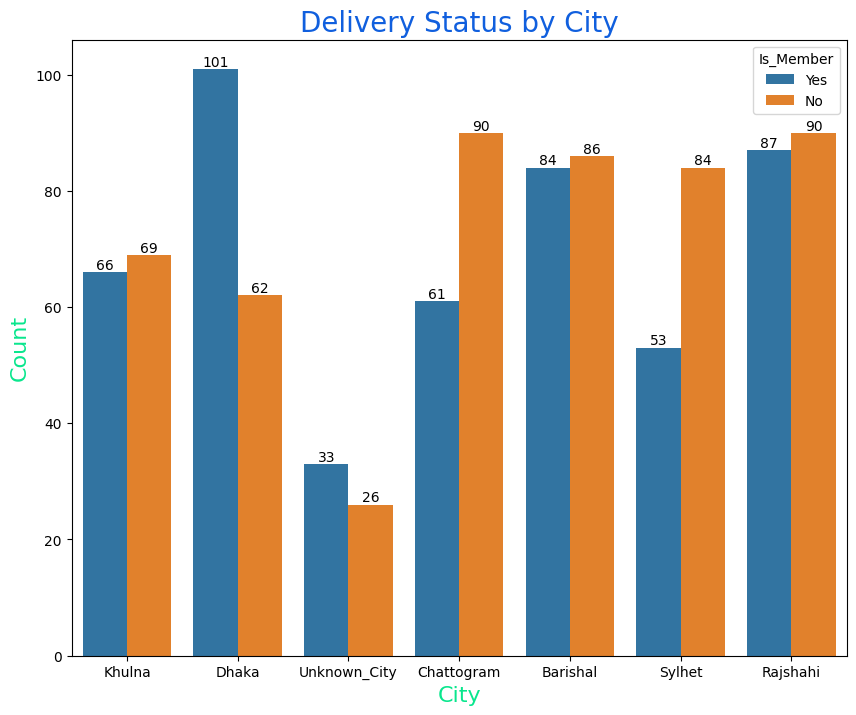 |
| 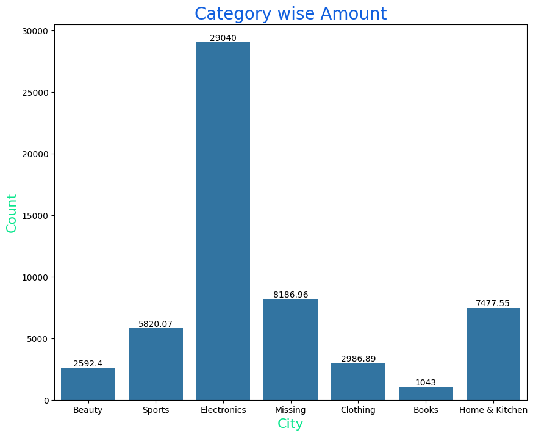 | 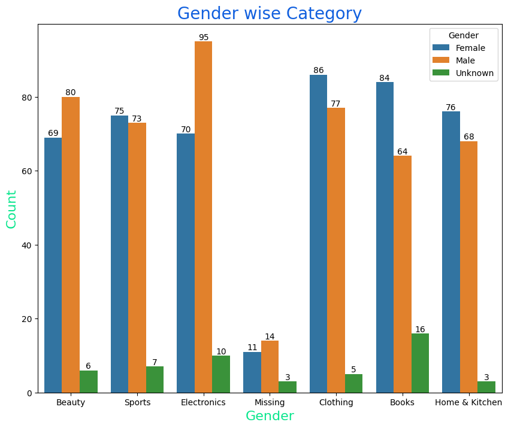 | 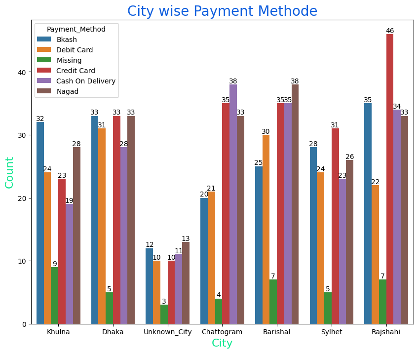 |
| 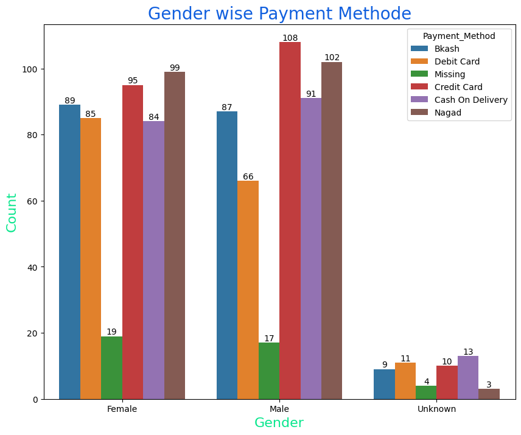 | 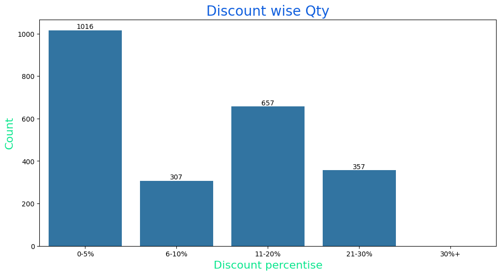 | 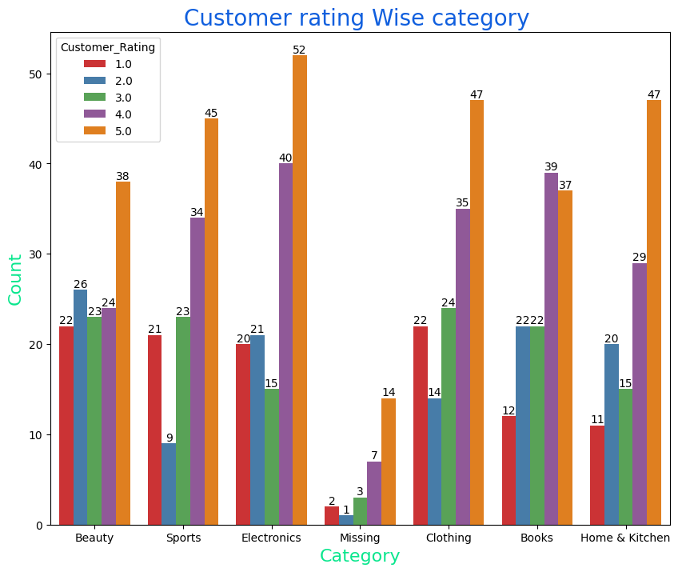 |

## Tech Stack

- Python 3
- Pandas, NumPy
- Matplotlib, Seaborn
- Jupyter Notebook

## How to Run

1. Clone or download this project.
2. Install the requirements:
   ```bash
   pip install pandas numpy matplotlib seaborn jupyter
   ```
3. Open Jupyter and run the notebooks in this order:
   ```bash
   jupyter notebook
   ```
   1. `Data_Cleaning.ipynb` -> reads `messy_ecommerce_orders.csv` and writes `Clean_data.csv`
   2. `Data_Visualize.ipynb` -> reads `Clean_data.csv` and creates the charts

> Keep the notebooks and CSV files in the same folder so the relative file paths work.

## Notes

- Some `Customer_Id` (12), `Order_Date` (20) and `Customer_Rating` (151) values are still missing in the clean data, as they could not be recovered reliably.
- Unknown categories and payment methods are kept as `Missing` / `Unknown` instead of dropping those rows, to preserve as much data as possible.

## Author

*Your name here*
